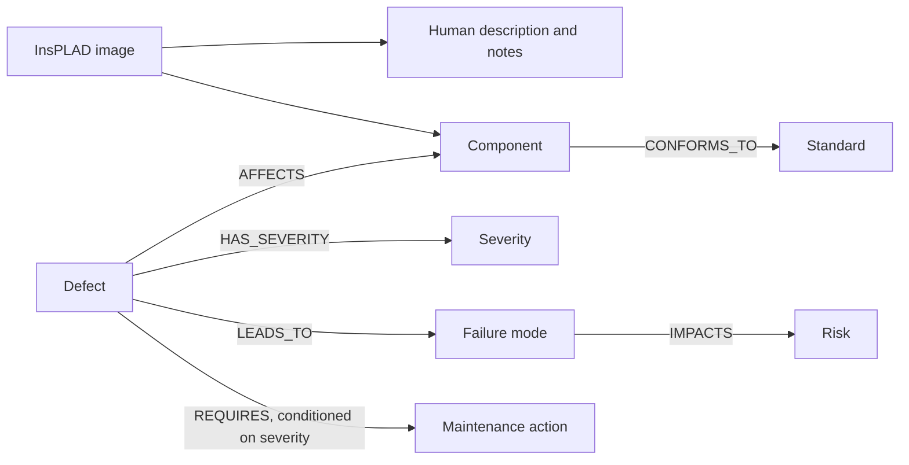

# PowerLine KG & Corpus

**A power-line maintenance knowledge graph and image-description resources covering 255 InsPLAD UAV images, with explicit annotation provenance.**

[](https://github.com/joyjitchatterjee/PowerLine-KG-Corpus/actions/workflows/validate.yml)
[](https://glow-workshop.github.io/iswc2026/)
[](CITATION.cff)

Companion data for **[Graph-Grounded Multimodal Agent for Trustworthy Power-Line Operations and Maintenance](https://joyjitchatterjee.github.io/assets/papers/glow-2026-power-line-om.pdf)**, presented at GLOW @ ISWC 2026.

Sania Verma, Joyjit Chatterjee, Jing Guo, Akash Marar, Rajendra Shankaran, Garima Sharma, Zekun Guo, and Anu Mehra.

[Paper PDF](https://joyjitchatterjee.github.io/assets/papers/glow-2026-power-line-om.pdf) | [85 human annotations](data/annotations.csv) | [255-record companion](data/companion_descriptions.csv) | [Data cards](docs/DATA_CARD.md) | [Load the KG](docs/KNOWLEDGE_GRAPH.md) | [Citation](#citation)

## Available resources

| Resource | Contents | Files |
|---|---|---|
| Human annotations | 85 descriptions, defect-presence labels, recommended actions, and annotator notes | [CSV](data/annotations.csv), [JSONL](data/annotations.jsonl) |
| Mixed-provenance companion | 255 descriptions: 70 labelled human in the supplied CSV and 185 template-generated | [CSV](data/companion_descriptions.csv), [JSONL](data/companion_descriptions.jsonl), [data card](docs/COMPANION_DATA_CARD.md) |
| Linked images | 255 original InsPLAD JPEG crops, identified by stable record IDs | [Images](data/images) |
| Domain knowledge graph | 18 component types, 5 defect types, 4 severity levels, failure modes, risks, standards, and actions | [Schema](ontology/schema.cypher), [Seed](ontology/seed_data.cypher) |
| Decision rules | 11 supported defect/severity combinations | [CSV](data/maintenance_rules.csv) |

The human corpus covers 17 component types, with five images each. All 85 records have complete descriptions, recommended actions, and notes. The human defect labels comprise 53 defect-present and 32 defect-absent records. Annotation wording, spelling, and uncertainty are preserved.

The companion covers the same 17 components with 15 images each. All 85 workbook images occur in the companion, so the release contains **255 unique images and 340 separately sourced description records**. The companion's 70 human-labelled descriptions differ from the workbook descriptions for those images. Both sources are preserved independently; neither silently replaces the other. Its 185 automatically generated descriptions exactly match the original label-and-ontology templates. They are not verified GPT outputs or human ground truth.

This repository releases reusable knowledge and descriptions. Evaluation predictions, model comparisons, scores, experimental splits, and simulation outputs are not included.



## Quick start

Offline use needs only Python 3.10 or later. No model API or database is required.

```bash
git clone https://github.com/joyjitchatterjee/PowerLine-KG-Corpus.git
cd PowerLine-KG-Corpus
python3 scripts/validate_release.py
python3 examples/explore.py
python3 examples/explore.py --defect corrosion --severity 2
```

Read the human descriptions and locate their images:

```python
import json
from pathlib import Path

root = Path('.')
records = [json.loads(line) for line in (root / 'data/annotations.jsonl').read_text().splitlines()]
record = records[0]
print(record['expert_description'])
print(record['recommended_action'])
print(root / record['image_path'])
```

For the companion, retain provenance when filtering records:

```python
companion = [json.loads(line) for line in (root / 'data/companion_descriptions.jsonl').read_text().splitlines()]
human_labelled = [row for row in companion if row['description_kind'] == 'human_labelled']
template_generated = [row for row in companion if row['description_kind'] == 'template_generated']
```

Use [the Neo4j guide](docs/KNOWLEDGE_GRAPH.md) to explore the graph or import the 85 workbook annotations. The loader continues to import only that source. Companion records are provided as separate CSV/JSONL files and are not imported as verified human observations. No severity or action is inferred from human text.

## Research uses

- Train or adapt inspection description models using image/text pairs.
- Study human descriptions of normal and defective power-line components.
- Build graph-grounded retrieval and maintenance reasoning methods.
- Extend the graph and annotations with independently reviewed evidence.

The annotations are a small curated sample from one source dataset. They are not a field safety certification. Free-text recommendations express annotator judgments and may differ from the graph's rules; see the [data card](docs/DATA_CARD.md).

## Citation

If you use the graph or annotations in research, please cite our paper and identify the release version or commit. GitHub's **Cite this repository** button uses [CITATION.cff](CITATION.cff) and prefers the paper citation.

```bibtex
@inproceedings{verma2026graphgrounded,
  title = {Graph-Grounded Multimodal Agent for Trustworthy Power-Line Operations and Maintenance},
  author = {Verma, Sania and Chatterjee, Joyjit and Guo, Jing and Marar, Akash and
            Shankaran, Rajendra and Sharma, Garima and Guo, Zekun and Mehra, Anu},
  booktitle = {2nd Workshop on Graph-enhanced LLMs for trustworthy Web data management (GLOW), co-located with ISWC},
  year = {2026},
  address = {Bari, Italy},
  url = {https://joyjitchatterjee.github.io/assets/papers/glow-2026-power-line-om.pdf}
}
```

Please also cite [InsPLAD](https://doi.org/10.1080/01431161.2023.2283900) when using its imagery or source labels. Both BibTeX entries are in [references.bib](references.bib). The workshop programme supports the paper citation; no unverified paper DOI or proceedings volume is supplied.

## Licensing and contributions

The original graph and documentation are **CC BY 4.0**, the image-and-annotation corpus is **CC BY-NC 3.0**, and Python utilities are **MIT**. See [LICENSE](LICENSE) and [third-party attribution](THIRD_PARTY_NOTICES.md).

Evidence-backed corrections and extensions are welcome. Include the record ID or graph relationship and the source of the proposed correction. See [CONTRIBUTING.md](CONTRIBUTING.md). If this resource supports your work, citing the paper helps others find and build on it.
